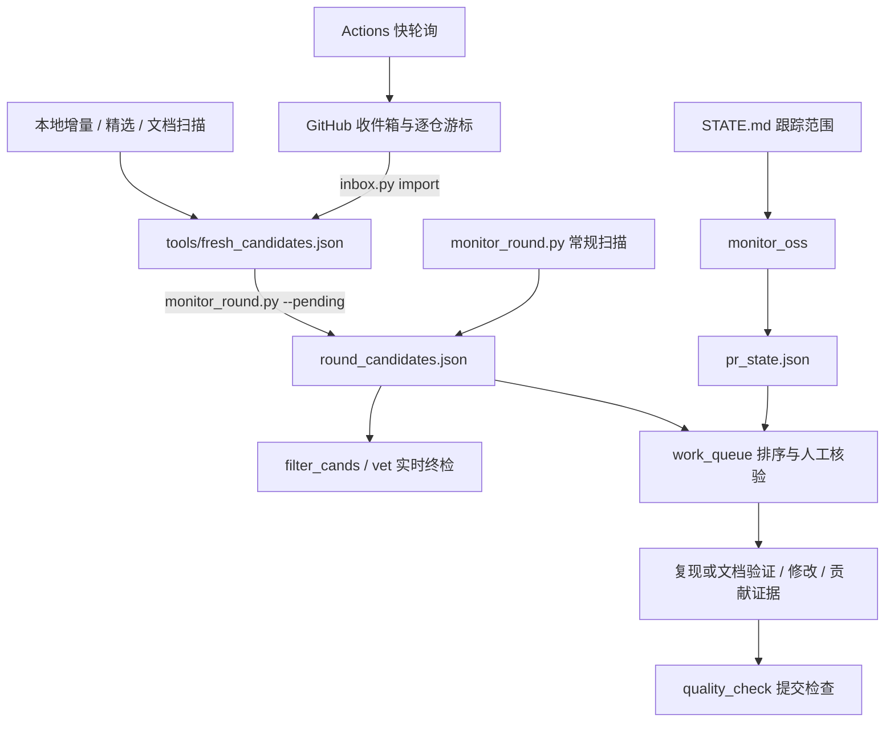

# zcode-PR — 开源贡献流水线

半自动化的 GitHub 开源贡献流水线:持续监控配置仓库池中的新 issue,自动评估撞车风险与政策合规,命中后以账号 `inchang-ing` 提交经过验证的贡献 PR（bug 修复、文档、小修及工具链改进，诚实披露 AI 协助）,并跟进全部在飞 PR 的评审与 CI。

> 工作模式:脚本辅助扫描,由对话中的 agent 完成复现、修复、回归验证与提交。

当前重心为高质量贡献：先完成真实路径验证、影响范围审查和必要的评审返工，再按仓库政策提交。每次返工重验，准确披露 AI 协助和验证局限，减少没有新信息的评论与同步。具体执行见 [RULES.md 的当前重心](RULES.md#当前重心高质量贡献2026-10-23)。

## 目录结构

```
E:\zcode-PR\
├── README.md            # 本文件
├── RULES.md             # 硬规则 / AI 政策 / 身份红线(动手前必读)
├── STATE.md             # 跟踪范围(在飞 PR 表,监控脚本解析它)
├── PR_STATUS.md         # 实时状态(自动生成,勿手改)
├── pr_state.json        # 机器可读权威状态
├── rounds-log.md        # 逐轮日志(追加式)
├── STATE-archive.md     # 历史归档(已合并/关闭 PR 的验证记录)
├── tools/               # 全部可执行代码
│   ├── monitor_round.py     # 权威仓库池扫描 → 候选
│   ├── scan_candidates.py   # 精选仓库池初筛，配置为 tools/quality_repos.json
│   ├── filter_cands.py      # 本地只读候选过滤(复用共享规则)
│   ├── vet.py               # 开 PR 前终检 CLEAN/WARN/DROP/UNKNOWN
│   ├── quality_check.py     # 首次提交/返工前检查版本、证据、正文和反馈对应关系
│   ├── auto_run.py          # 候选 → PR 落地管线(修复钩子未接入,见下)
│   ├── monitor_scope.py     # 在飞 PR 状态 → pr_state.json + PR_STATUS.md
│   ├── monitor_oss.py       # 在飞 PR + CI 检查
│   ├── monitor_fresh.py     # 配置仓库池的新 issue 增量监控
│   ├── pr_status.py         # 单 PR 状态查询
│   ├── feishu_push.py       # 飞书通知(自愈式)
│   ├── repository_pools.py / .json     # 各扫描通道的纯配置与规范化
│   ├── scan_agent*.py / scan_recon*.py  # 旧命令兼容入口
│   ├── task_state.py / session_claims.py / discovery_state.py
│   └── pipeline_state.py / pr_state.py / github_read.py / gh_checks.py
├── tests/               # 离线回归测试
├── repo-monitor/        # 私有 Git 子模块:独立通知程序与离线测试
├── work/                # 活跃工作台:克隆 / 复现 / 临时产物；仅保留扫描兼容入口
├── workspaces/          # 各仓库克隆 + venv(gitignore,可重建)
└── archive/             # 归档的早期一次性脚本
```

## 架构与边界



`candidate_rules.py` 统一候选结构、贡献分类与筛选规则；`repository_policy.py`、`claim_rules.py` 负责仓库与认领门禁。`task_state.TaskStore` 将收件箱处理、队列阶段和派发记录统一保存在根目录 `task_state.json`，所有写入使用同一文件锁与原子替换；原有完成/重开/派发判断不变。旧三份 JSON 只在迁移前兼容读取，迁移后保留作历史原件；备份、升级和回退步骤见 [QUEUE_GUIDE.md](QUEUE_GUIDE.md#统一状态存储与迁移)。生成视图不作为状态来源，`STATE.md` 仍负责声明需要跟踪哪些 PR。

本地、精选、快轮询和 `repo-monitor` 的池用于不同扫描范围，数量由各配置决定。本地执行统一经过精确核验与提交门禁。当前云端定时扫描由主仓 `fresh-issue-poll` 承担；`repo-monitor` 保留独立通知代码与 CI，定时通知已停用，不承担本地任务调度。两边的 `notification_contract.py` 由测试校验源码一致性，仅忽略 Git 检出时的 LF/CRLF 换行差异；展示文本统一转义，机器事件使用带版本的编码载荷，旧评论仍可读取。

## 跑一条流水线

```powershell
python -S tools/monitor_round.py --out round_candidates.json   # 扫描权威池 → 候选
python -S tools/filter_cands.py                                # 本地只读过滤(不联网)
python -S tools/vet.py --candidates round_candidates.json      # 开 PR 前终检
```

`tools/fresh_candidates.json` 是待核验收件箱；`round_candidates.json`（仓库根）是**精确核验后的权威候选文件**,`auto_run.py` 与 `vet.py` 都读它。
只有终检为 `CLEAN` 的候选才能进入人工判断(`UNKNOWN` 必须复核)。之后:复现 → 修复 + 回归测试 → 覆盖率自检 → 提 PR,遵守 `RULES.md`。

候选包含 `kind=bug/docs/small_fix/tooling`，旧记录默认 bug。终检使用实时标题、标签和分配人重新判定资格；文档类不再被 bug 专用过滤器误删，但类型不能替代政策、撞车、维护者意图或验证证据。精选池撞车检查区分完整仓库引用，其他仓库的同号 issue 不会排除本仓候选。
终检要求返回的 issue 编号与请求一致；正文已明确认领、暂不接受 PR 或实时分类已不符合条件时直接淘汰，避免额外查询时间线和评论。其余候选仍完整读取分页，未知结果不能放行。

精选仓库池的初筛使用 `python -S tools/scan_candidates.py --days 4 --max 5`，仓库池维护在 `tools/quality_repos.json`。旧命令 `python -S work/scan_candidates.py` 保留为兼容入口，两者执行同一份代码。初筛保留仓级 PR 引用预筛，不再重复逐 issue 查询时间线和评论；完整核验由 `monitor_round --pending` 和提交前 `vet` 执行。初筛报告仍输出到 `work/ledger/candidates.json`，发现同时进入 `tools/fresh_candidates.json`；随后运行 `monitor_round.py --pending`，不要把初筛报告直接传给终检。`scan_docs.py` 也走同一待核验收件箱；查询失败记为 `UNKNOWN` 并返回非零，不能当作没有撞车或认领。在飞判断优先读取 `pr_state.json`，只有该文件不存在时才回退旧台账；权威缓存损坏时直接报错。

常规扫描对最新十条之外的已有候选按编号复核；查询失败时保留并标为未知，确认关闭或不合格后才移除。
`--pending` 在查询前跳过已处理和未到期延期任务，保留其记录；显式重开或到期后恢复核验。联网期间不占用收件箱写锁，新发现可继续写入；扫描结束只移除本轮确实核验过且内容未变的条目。重复导入没有新增项时不重写收件箱。消费结果保存在 `tools/discovery_state.json`；同一来源版本只核验一次，来源内容变化或显式重开才重验。先写消费记录再删除收件箱条目，删除中断后可直接恢复。

> `auto_run.py` 的自动修复钩子(FIXERS)目前**未接入**。以后接入钩子也只准备本地补丁，停在 needs_verification；须落入目标 Git checkout，完成最终提交与证据检查后按规则提交。此入口不自动推送或创建 PR。

本地补丁的变更记录包含新增、修改和删除；仅删除文件或重命名同样进入待验证阶段。
真实运行先获取 `session_claims` 的所有权凭证，执行结束在 `finally` 中按凭证释放；旧会话不能释放后来会话的认领。没有注册复现或修复钩子的候选只登记为 needs_repro，不消耗本轮全局及同仓准备名额。
`auto_run.py` 的执行限额接受非负整数，零表示不执行；非法数值或未知参数在读取候选和状态之前报错退出。

源码下载拒绝覆盖已有工作目录，避免丢失未提交修复；归档先在临时目录中按 `tarfile.data_filter` 解包，失败时清理本次临时目录。发布中断时保留已创建目标供检查，重试仍拒绝覆盖。

本地准备不要求所有候选先发占位留言；讨论和分配按目标仓库政策执行，已有仓库限制、分配门禁和并发限制继续生效。

本地会话认领后保留返回的 `token`，释放和续期必须携带同一凭证：

```powershell
python -S tools/session_claims.py --claim owner/repo#123 --holder my-session
python -S tools/session_claims.py --renew owner/repo#123 --token <返回的token>
python -S tools/session_claims.py --release owner/repo#123 --token <返回的token>
```

已有无凭证认领仍占用到原定 48 小时到期，不会自动冒领或清除；到期后重新认领获取凭证。

## 合并产出工作队列

默认扫描结束后自动生成 [工作队列](WORK_QUEUE.md)，将候选核验、复现和已有 PR 的修改请求放在一起排序。
使用 `python -S tools/work_queue.py refresh` 可离线刷新队列和 [七天产出统计](WEEKLY_CONTRIBUTIONS.md)。
Markdown 默认只展示前 50 项，`refresh --limit 0` 展示全部；`work_queue_view.json` 始终保留完整任务和过滤原因。
`inbox.py done/reopen` 与队列的 stopped/submitted/new/probe 阶段共享处理结论，重复扫描不能复活已处理任务；重开必须显式记录理由。
队列刷新逐条读取贡献元数据和证据路径，异常记录显示在 Markdown 与 JSON 中，不阻断无关任务；用于反馈确认的来源仍完整校验。历史测试日志的内容摘要留给 `contributions.py check` / `quality_check.py` 严格检查，队列展示不代表证据通过。扫描结果已保存而视图刷新失败时，扫描命令退出 2 并提示单独重刷视图。
阶段、退出原因、实际工时及反馈分类的操作见 [试运行说明](QUEUE_GUIDE.md)。缺少政策、撞车或维护者意图证据的候选只能先核验；高分不能绕过门禁。
自有仓库的候选、PR 和工时均排除在外部贡献视图之外，原始历史记录继续保留。

## 可验证贡献记录

每项贡献保存在 `contributions/records/`，证据保存在 `contributions/evidence/`。格式和录入方法见 [贡献记录说明](contributions/README.md)。

```powershell
python -S tools/contributions.py check
python -S tools/contributions.py render
```

生成的 [贡献台账](CONTRIBUTIONS.md) 包含政策、撞车、测试证据、反馈、建议待办，以及按仓库/问题类型/修复方式的样本统计。历史陈述与已核验事实分开，PR 状态只读取现有缓存。首版不替换 `STATE.md` 的监控范围。

首次提交和每次返工推送前，执行 `tools/quality_check.py prepare/check`，核验最终提交、测试日志、实际 PR 正文和反馈处理是否对应。具体命令见 [提交前与返工检查](contributions/README.md#提交前与返工检查)。旧记录可以继续读取，但缺少新版证据字段时不会通过提交检查。

## 云端发现与停止开关

```powershell
python -S tools/inbox.py list
python -S tools/inbox.py import
python -S tools/monitor_round.py --pending
python -S tools/pipeline_switch.py status
python -S tools/pipeline_switch.py off
```

快轮询按仓库保存成功游标，持久化在 GitHub 收件箱正文的 `zcode-poll-state` 隐藏块中；重启或超过六小时的中断继续从原游标补扫。完整发现写入评论后才推进成功仓库的游标，失败仓库原位重试。请保留该隐藏块；人工说明可以正常编辑。首次运行没有游标时使用初始回看窗口，结合可查到的上次成功运行时间扩展，不保证导入全部历史 issue。

单轮成功返回 0，部分失败返回 2，全部失败或发布失败返回 1；循环保留最后一轮的结果，最后一轮补扫成功可恢复此前失败。关闭返回 42，由循环作为正常停止处理。`--dry-run` 只读取远端，不发布评论或推进游标。

开关统一写入 `true/false`，兼容读取旧 `on/off`。查询失败显示 UNKNOWN 并返回非零，不能当作未设置。`off` 默认还会取消正在运行的 shift；`--keep-running` 保留运行时，若 token 不能读取 Variables API，该 shift 可继续使用启动时的值直到结束。新 job 仍检查当前开关。控制台本地镜像写入失败也会明确报错。

## 状态与监控

```powershell
python -S tools/monitor_oss.py                      # 每轮一次：在飞 PR 状态、评审、合并信息及 CI
python -S tools/monitor_fresh.py                    # 配置仓库池的新 issue 增量
python -S tools/pr_status.py <owner/repo> <pr_num>  # 查单个 PR
```

- **权威源 = GitHub**。`pr_state.json` 是机器可读状态;`PR_STATUS.md` 是自动生成的只读视图(勿手改);`STATE.md` 只声明跟踪范围(两张 `OPEN(...)` 表)。
- PR 身份不区分仓库名大小写；旧缓存中的重复记录按状态和 CI 各自的核验时间归并，无法确定先后的冲突直接报错并保留原文件。读取归并不改写台账。
- `review_sweep.py` 和 `maintainer_sweep.py` 共用这一读取规则，避免重复查询同一 PR 或将别名重复计入同仓名额。
- `monitor_scope.py` 是不查 CI 的按需入口；常规轮次只运行 `monitor_oss.py`，无需连续查询同一批 PR。两个入口读取不完整时均保留成功结果并返回非零退出码。
- 状态原子落盘遇到 `PermissionError` 最多再试两次，每次间隔 20 毫秒；其他错误直接上报，持续失败时保留旧快照。
- 两个 PR 入口最多并发查询 4 条；单项失败最多尝试两次，仅在重试前等待 2 秒。找不到 GitHub CLI 时直接报告失败。轮次锁覆盖查询与原子落盘，避免两个入口同时改写状态。
- 常规候选扫描的限流和超时等待只发生在重试之前；重试耗尽后立即报告失败。
- 增量扫描拒绝新 issue 的非法编号，失败仓库的游标保持不动；部分或全部仓库失败时返回非零，成功仓库的结果仍保存，`--init` 同样报告不完整轮次。
- `pr_status.py` 完整分页读取评审、普通评论、行内评论、Check Runs 和传统 commit statuses，再显示最近反馈及检查汇总。任一读取失败标记 `UNKNOWN`，仍继续检查其余 PR，最后返回非零退出码。
- `review_sweep.py` 完整读取评论、评审分页；`revival_scan.py` 完整读取时间线，并用来源仓库查询关联 PR。读取失败或作者身份不明会显示 `UNKNOWN` 并返回非零，继续检查其他条目；复查 JSON 的 `unknown` 列表记录未完成项。
- `review_sweep.py --since` 接受带时区的 ISO 8601 时间，统一换算 UTC 比较。非法参数直接报错；PR 或活动时间损坏时标记该 PR 为 `UNKNOWN`，继续检查其他 PR。
- `repo-monitor/` 是独立私有仓库，通知程序只推送新 issue 与在飞 PR 变化，不执行贡献任务。其定时监控工作流已停用，本次发布保留停用状态。通知为 best-effort：飞书认证/发送失败时状态仍落盘，未送达事件记入子仓 `undelivered.jsonl`（保留最近 200 行）作兜底记录。

## 离线验证

```powershell
python -S -B -m unittest discover -s tests -v
# 已初始化并有权限访问 repo-monitor 时，另跑子仓独立测试：
python -S -B -m unittest discover -s repo-monitor/tests -v
```

测试使用假 API 与临时状态，不扫描真实仓库、不发送通知。主仓 `.github/workflows/tests.yml` 在 Windows/Linux 上只运行主仓测试，不检出私有子模块。未初始化 `repo-monitor` 时，仅两项跨仓检查明确跳过（摘要输出与协议文件一致性），其余监控和协议测试照常运行；本地已检出子仓程序时，这两项自动执行，协议缺失或实现错误仍会失败。子仓自身的 `.github/workflows/tests.yml` 独立运行其测试。本地通过不代表云端工作流已执行。

## 飞书通知

- 账号为豆包账号个人版飞书,该租户永久禁用机器人单聊(230101)与群自定义机器人 webhook → 一律走**自建应用机器人 + 机器人自建群**。
- 凭证:`C:\Users\ROG\.Codex\feishu.json`(含 SECRET,**绝不入库**)。
- 推送:`python tools/feishu_push.py "标题" "**markdown** 正文"`;自愈:`python tools/feishu_push.py --ensure`。

## 环境 / 换机

- 需要保留 **GitHub 云端记录**、**代码和规则/台账**，以及 **`contributions/` 的记录与证据**；clone、venv 等可重建，原始核验日志不能当作可重建缓存丢弃。
- 新机器:装 git 与 GitHub CLI → `gh auth login` → SSH 走 443(`~/.ssh/config` 指向 `ssh.github.com:443`)→ 拷规则与脚本 → 按需 `git clone` + `python -m venv <repo>-venv` + `pip install -e .`。
- 装完必验:`python -c "import <包名>; print(<包名>.__file__)"` 必须指向克隆目录(防 site-packages 遮蔽)。

## git 安全网

- 本目录已是 git 仓库；`workspaces/`、`work/`、`.trash/`、`*-src`、`*-venv`、各类缓存均被 `.gitignore` 忽略，`work/scan_candidates.py` 兼容入口除外。长期扫描代码和仓库池位于 `tools/`，应随代码一起保存。
- 回滚:`git checkout -- <file>` 或 `git revert <sha>`;查看历史:`git log --oneline`。
- `repo-monitor/` 由 `.gitmodules` 声明；新克隆使用 `git clone --recurse-submodules <根仓库地址>`，已有克隆运行 `git submodule update --init --recursive`。
- 子模块修改须先在 `repo-monitor/` 提交，再在根仓库提交子模块指针。发布时先推送子仓库提交，再推送根仓库；仅有本地子仓库提交时，其他机器不能从远端恢复该版本。

## 增量收件箱与公共模块

`inbox.py` 首次读取完整评论，之后按更新时间增量读取，并在 `tools/inbox_comments.json` 保留本地缓存；网络或解析失败不推进游标。该缓存可重新下载，`tools/discovery_state.json` 则是已核验来源的持久记录，应与任务状态一起保留。云端快轮询的去重也只重读上轮成功后的恢复窗口，发送或 checkpoint 失败仍重放未完成批次。

仓库池数据在 `repository_pools.json`，各通道仍使用自己的范围；共享加载器负责规范名称及重复项处理。政策规则与证据来自同一份结构化记录，贡献类型例外由 `allowed_kinds` 执行。监控入口共用 PR 解析和观测比较；`github_read.py` 负责 CLI 定位、编码、超时及分页错误。主仓与通知子仓各自运行离线测试，主仓任一工作流修改均触发回归。
